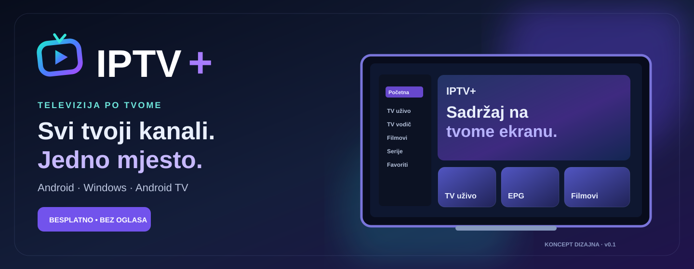
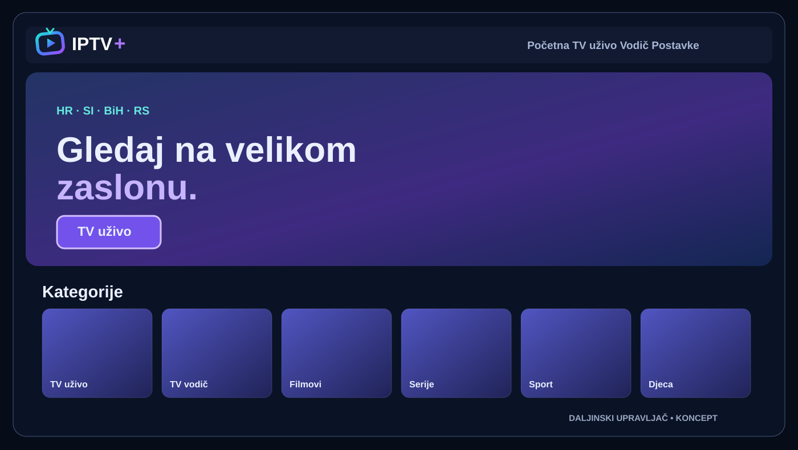

<div align="center">


# IPTV+ — Televizija po tvome

**Jedna aplikacija. Sve dostupne napredne funkcije. Android · Android TV · Windows.**




</div>

## 📺 Tvoj TV centar

IPTV+ temelji se na [clubTivi](https://github.com/clubanderson/clubTivi) Flutter playeru (Apache 2.0). **Nema odvojenih Free i Pro paketa**: sve prethodno Pro-om omogućene funkcije uključene su u jednom IPTV+ proizvodu, bez obveznog računa ili reklamnih SDK-ova.

| TV i video | Regije | Mogućnosti |
|---|---|---|
| M3U / Xtream Codes | 🇭🇷 Hrvatska | Favoriti, pretraga |
| EPG / XMLTV | 🇸🇮 Slovenija | Smart Channels i failover |
| Multiview i reproduktor | 🇧🇦 BiH | TV daljinski |
| Odabir javnih lista | 🇷🇸 Srbija | Automatsko osvježavanje odabranih izvora |

## 🎨 Brending Androida, Windowsa i TV-a

| Windows — koncept | Android — koncept |
|---|---|
|  |  |

<div align="center"></div>

[**Galerija 39 SVG prikaza ekrana**](assets/screens/README.md) — dizajnerske reference, ne screenshots gotovih aplikacija.

## 📦 Svaki GitHub Release sadrži četiri datoteke

- `IPTV-Plus-vX.Y.Z-Unsigned.apk` — Android razvojni paket (nije instalabilan)
- `IPTV-Plus-vX.Y.Z-Unsigned.aab` — Android App Bundle (nije spreman za Play)
- `IPTV-Plus-vX.Y.Z-Portable.exe` — Windows bez instalacije
- `IPTV-Plus-vX.Y.Z-Setup.exe` — Windows instalacija

Uz `SHA256SUMS.txt`, bilješke i ZIP punog brendinga. Izdanja se neće objavljivati dok četiri stvarna paketa nisu potvrđena; Android paketi ostaju nepotpisani i neprikladni za instalaciju/Google Play. [Pravila izdavanja](docs/RELEASE_POLICY.md).

## ⚙️ Pokretanje razvoja

```bash
git clone --recurse-submodules https://github.com/bren-wp/IPTV-.git
cd IPTV-
npm install
npm run tauri -- icon assets/brand/iptv-plus-icon.svg
python3 tools/clubtivi/prepare.py --icon-png src-tauri/icons/128x128@2x.png --icon-ico src-tauri/icons/icon.ico --version 0.2.0
cd vendor/clubTivi
flutter pub upgrade
flutter test
flutter build apk --debug
```

[Arhitektura](docs/ENGINE_MIGRATION.md) · [Ažurirane ovisnosti](docs/DEPENDENCIES.md) · [Sigurnost](docs/SECURITY.md) · [Izvori](docs/GITHUB_SOURCES.md) · [Autorstvo i licence](THIRD_PARTY_NOTICES.md)

**Razvojno stanje:** potrebno je završiti CI i fizičku provjeru objedinjene verzije, potpise i pixel-perfect usklađivanje svih zaslona. Vizuali su koncepti.

IPTV+ ne uključuje neovlaštene premium streamove, ne zaobilazi DRM, a prisutnost javnog M3U URL-a nije dokaz prava na emitiranje. Prava na sadržaj, logotipe i EPG provjeravaju se zasebno.

<div align="center">

**IPTV+ by Brendigo** · [Issues](https://github.com/bren-wp/IPTV-/issues) · [Releases](https://github.com/bren-wp/IPTV-/releases)

</div>

**Potpisivanje nije dio ovog CI-a:** za Android instalaciju i Play ipak će biti potreban potpis. Nepotpisani Android paketi mogu služiti samo za analizu i naknadno potpisivanje.
