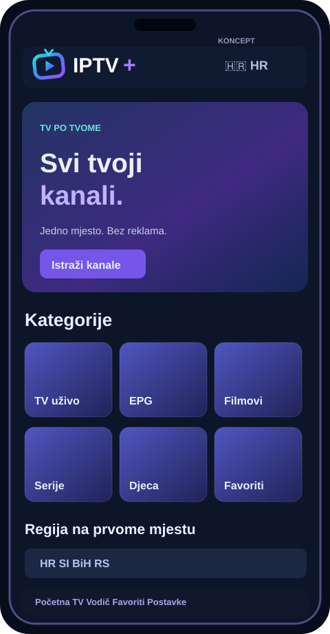

## Glavni reprodukcijski engine: clubTivi / Flutter

**IPTV+ sada se razvija primarno kao Flutter aplikacija zasnovana na originalnoj
clubTivi jezgri (Apache 2.0)**. Tauri/React je početni razvojni prototip i
referenca dizajna, a ne predviđeni produkcijski engine za sljedeća izdanja.
Naš autorski IPTV+ Flutter početni zaslon, logo i regionalni prikaz nadograđuju
postojeću reprodukciju, EPG, Xtream i podršku za daljinski.

- [Plan i arhitektura migracije](docs/ENGINE_MIGRATION.md)
- [Adapter i Flutter IPTV+ home](tools/clubtivi/README.md)
- [Izvorni autor i licence](THIRD_PARTY_NOTICES.md)

Nativna instalacijska izdanja Android/Windows još zahtijevaju signing i QA;
nisu predstavljena kao gotova dok sve provjere ne prođu.

<div align="center">


# IPTV+ — Televizija po tvome

**Regionalno usmjeren IPTV reproduktor za Android, Android TV i Windows.**  
Hrvatska · Slovenija · Bosna i Hercegovina · Srbija


**⚠️ DEVELOPMENT PREVIEW:** Screens below are illustrative **design concepts**, not captured screenshots of tested Android/Windows binaries. No preloaded premium channel streams or subscription access are included.

</div>

## ✨ Tvoj TV centar, bez suvišnih prepreka

IPTV+ je projekt otvorenog koda s prepoznatljivim tamnim izgledom i jedinstvenim korisničkim iskustvom na mobitelu, velikom ekranu i računalu. Nema obveznog računa ni reklamnih SDK-ova. Korisnik unosi vlastite izvore sadržaja za koje ima pravo pristupa.

| 📺 TV i mediji | 🌍 Regionalni pregled | ⚡ Kontrola i privatnost |
|---|---|---|
| TV uživo, filmovi, serije, dječje kategorije | HR, SI, BiH, RS filteri | Lokalni M3U uvoz |
| HTML5 + HLS.js osnovni reproduktor | Pretraživanje, favoriti | Nema registracije ni oglasa |
| Osnovni dizajn EPG-a (još bez stvarnog XMLTV-a) | Responsivan dizajn | Free i Pro način su trenutačno besplatni |

## 🖼️ Dizajn za svaki ekran

| Windows desktop — koncept | Android — koncept |
|---|---|
|  |  |

### 📺 Android TV — koncept

<div align="center">

</div>

## 🎯 Free vs. Pro

Oba načina rada u ovom razvojnome izdanju su **besplatna**. Pro ne daje pristup plaćenim TV kanalima.

| Funkcija | IPTV+ Free | IPTV+ Pro |
|---|:---:|:---:|
| Sučelje bez oglasa i registracije | ✅ | ✅ |
| Vlastiti M3U izvori | 1 lista | Više lista |
| Favoriti | Do 10 | Neograničeno |
| Regionalni pregled / pretraga | ✅ | ✅ |
| Osnovni HTML5 / HLS player | ✅ | ✅ |
| XMLTV, Xtream, snimanje, catch-up, PiP | U planu | U planu |

## 🛠️ Tehnologije

- **Tauri 2** — izvorna host aplikacija za Windows i Android, zajednički UI.
- **React 19 + TypeScript + Vite 6** — aplikacijska logika i responzivni ekrani.
- **hls.js** — HLS reprodukcija kada je podržana u WebView okruženju.
- **Lucide** — konzistentne vektorske ikone.
- **Rust** — minimalna Tauri host jezgra.

## 🚀 Pokreni razvojni pregled

Preduvjeti: Node 22+ i npm. Za nativnu aplikaciju dodatno Rust/Tauri; Android SDK/NDK za Android.

```bash
git clone https://github.com/bren-wp/IPTV-.git
cd IPTV-
npm install
npm run dev
```

Provjere:

```bash
npm run build
npm test
```

Windows s Tauri okruženjem:

```bash
npm run tauri dev
```

Android nakon instalacije [Tauri Android preduvjeta](https://v2.tauri.app/start/prerequisites/):

```bash
npm run tauri android init
npm run tauri android dev
```

**Nativne Android/Windows binarne datoteke još nisu izgrađene, potpisane niti funkcionalno testirane.** Za budući Windows installer potrebno je pripremiti .ico/.png iz SVG ikone.

## 🧭 Stanje razvoja

**Trenutačno dostupno:** dizajn aplikacijske ljuske, navigacija, regionalni filteri, pregled kategorija, pretraga, favoriti, lokalni M3U uvoz, demonstracijski EPG raspored i osnovni HLS/HTML5 player. Demo kartice jasno su označene i **nemaju stream URL-ove**.

**Planirano, ali još nije dostupno:** automatski ažurirani legalni katalog, XMLTV, Xtream povezivanje, lokalno sigurno spremanje izvora, stvarni Android TV daljinski upravljač, napredni profili, roditeljska kontrola, lokalizacije, snimanje, instaleri i potpuna provjera na fizičkim uređajima.

Dokumenti: [Brand & UI matrica](docs/BRAND.md) · [Razvojni plan](docs/ROADMAP.md) · [Arhitektura](docs/ARCHITECTURE.md) · [Sigurnost](docs/SECURITY.md) · [Prava na sadržaj](docs/LEGAL.md)

## ⚖️ IPTV i prava na sadržaj

IPTV+ **ne uključuje piratske liste, premium streamove, korisničke račune ili mogućnost zaobilaženja DRM zaštite**. Za Arena Sport i druge zaštićene kanale potrebna su odgovarajuća prava i autorizirani izvori. Javna M3U adresa nije dokaz prava na redistribuciju.

## 🤝 Doprinos projektu

Prijavi problem putem [GitHub Issues](https://github.com/bren-wp/IPTV-/issues). Prije prijave priloži uređaj, OS verziju, vrstu problema i korake ponavljanja, ali **ne objavljuj privatne IPTV URL-ove, pristupne podatke ili tuđe zaštićene sadržaje**.

<div align="center">

---

**Made with ♥ by Brendigo** · [MIT License](LICENSE)  
⭐ Ako ti je projekt zanimljiv, podrži ga GitHub zvjezdicom.

</div>

## 🎨 Svi pojedinačni prikazi ekrana

**39 samostalnih SVG dizajnerskih koncepata** za Android, Windows i Android TV,
uključujući Splash, Početnu, TV uživo, EPG, Filmove, Serije, Djecu, Favorite,
Pretragu, Izvore, Postavke, Reproduktor i Free/Pro:

➡️ [Otvori cijelu galeriju dizajna](assets/screens/README.md)

## 📦 Obavezni paketi za svako novo izdanje

Svaki novi GitHub Release mora sadržavati **Free i Pro** zasebne Android APK/AAB
i zasebne Windows Portable.exe/Setup.exe, te SHA-256 sumu, release notes i
ZIP sa svim grafičkim elementima. Automatizacija neće objaviti nepotpuno izdanje.
Pravila: [RELEASE_POLICY.md](docs/RELEASE_POLICY.md).

**Stanje:** nativni buildovi zahtijevaju odgovarajuće GitHub Secrets za Android
potpisivanje; još nisu izvršeni. Pro nije samo prekidač u Free aplikaciji,
nego zasebni paket. Za unos unaprijed pripremljenih regionalnih izvora
potrebna su dokumentirana prava ([CATALOG.md](docs/CATALOG.md)).

## 🌐 Regionalne GitHub IPTV zbirke na jedan klik

U prozoru **Izvori i liste** ponuđene su javne zbirke `iptv-org` (HR, SI, BiH, RS),
uređivani `Doubo Public Channel Directory` (HR, BiH, RS) te
`biskyt/legalFreeIPTVplaylist` (TV, filmovi i serije s opisanom pravnom podlogom).

Korisnik aktivira izvor i kanali se dohvaćaju izravno na njegov uređaj, bez poslužitelja IPTV+.
Aktivirane liste ponovo se osvježavaju pri pokretanju i **svakih 12 sati dok je aplikacija otvorena**.
Za odabrane javne izvore spremaju se samo ID-ovi, bez pristupnih podataka.
Pojedini izvori mogu biti nedostupni zbog CORS-a, geoblokade ili prava emitera.

Zbirke i postupanje s pravima detaljno: [GitHub sources](docs/GITHUB_SOURCES.md).

## ⚡ Opcionalni clubTivi Flutter engine

U repozitorij je dodan **pinned Apache-2.0 Git submodule** `vendor/clubTivi`
i stvarni `tools/clubtivi/prepare.py` rebrand adapter. On u lokalnoj kopiji
originalnog projekta mijenja naziv/ikone/boje, Android Free/Pro package ID,
aktivira Free/Pro feature gate te dodaje **10 regionalnih i javnih lista
na jedan klik** u postojeći clubTivi Providers zaslon.

Službeni Tauri kod u `src/` ostaje glavni razvojni paket dok ne prođu
Flutter testovi, novi dizajn, izvori i sva 8 obvezna build artefakta.

- [Detaljne upute za clubTivi rebrand](tools/clubtivi/README.md)
- [Treće strane i licence](THIRD_PARTY_NOTICES.md)
- [Test rebrand adaptera](.github/workflows/clubtivi-smoke.yml)

*Rebrand adapter je razvojni alat: produkcijski Flutter APK/AAB i Windows
Portable/Setup još nisu provjereni i nisu objavljeni.*
