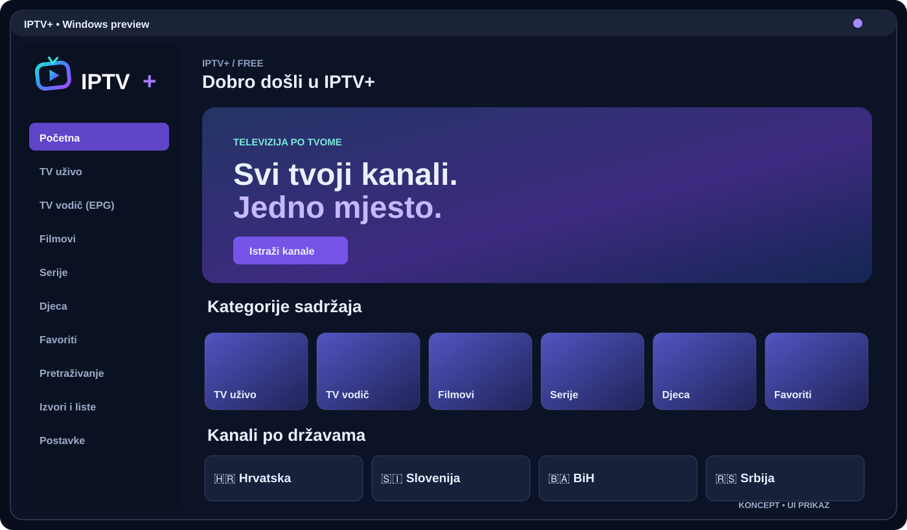

# IPTV+
### Televizija po tvome.

**Tvoji kanali. Tvoj raspored. Tvoj ekran.**

TV uživo, filmovi, serije i najdraže emisije — pregledno organizirani na jednom mjestu.

---

## 📺 Sve što voliš gledati

| 📡 TV uživo | 📅 TV vodič | ⭐ Favoriti |
|---|---|---|
| Pristupi svojim kanalima brzo i jednostavno. | Pogledaj što se emitira i što slijedi. | Najdraži sadržaj uvijek nadohvat ruke. |

| 🎬 Filmovi i serije | 🔎 Pretraga | 🧩 Tvoji izvori |
|---|---|---|
| Pregledaj sadržaj po kategorijama. | Pronađi kanale i emisije u nekoliko dodira. | Poveži vlastite M3U, Xtream i dostupne javne liste. |

## 🌍 Prvo naša regija

**🇭🇷 Hrvatska &nbsp; 🇸🇮 Slovenija &nbsp; 🇧🇦 Bosna i Hercegovina &nbsp; 🇷🇸 Srbija**

Pregled regionalnih javnih IPTV zbirki, omiljeni kanali i mogućnost dodavanja drugih izvora. Odabrane liste mogu se osvježavati automatski tijekom korištenja aplikacije.

## ✨ Jedan IPTV+. Sve mogućnosti.

Nema odvojenih Free i Pro aplikacija, nema obvezne registracije ni oglasa koje umeće IPTV+.

- **M3U i Xtream** — jednostavno poveži svoje izvore.
- **EPG / XMLTV** — raspored emisija na jednom mjestu.
- **Smart Channels** — pametnije upravljanje dostupnim streamovima.
- **Više izvora** — sve što gledaš, objedinjeno.
- **Upravljanje daljinskim** — udoban pregled i na televizoru.

## 🖥️ Dizajn za svaki ekran

### Windows

*Udoban prozorski prikaz koji se prilagođava radnoj površini.*

### Android

*Jednostavna navigacija i brz pristup televiziji na mobitelu.*

### Android TV

*Velike kontrole, kartice i upravljanje daljinskim upravljačem.*

Vizualni prikazi služe za predstavljanje dizajna aplikacije. Ne predstavljaju fotografije stvarnih uređaja.

## ⬇️ IPTV+ na tvom uređaju

[**Pogledaj GitHub izdanja**](https://github.com/bren-wp/IPTV-/releases)

| Android | Windows |
|---|---|
| APK i AAB | Portable.exe — bez instalacije |
| Jedna aplikacija | Setup.exe — standardna instalacija |

Trenutačni Android paketi su nepotpisani razvojni paketi: za instalaciju APK-a i predaju AAB-a trgovini potreban je digitalni potpis. Windows može prikazati upozorenje za nepotpisanu aplikaciju.

## ❤️ IPTV+ by Brendigo

**Jednostavnije gledanje. Više mogućnosti. Tvoj izbor.**

[Galerija svih zaslona](assets/screens/README.md) · [Izdanja](https://github.com/bren-wp/IPTV-/releases) · [Prijavi problem](https://github.com/bren-wp/IPTV-/issues)

IPTV+ je neovisna aplikacija zasnovana na otvorenom projektu [clubTivi](https://github.com/clubanderson/clubTivi), uz poštivanje Apache 2.0 licence. [Autorska prava](THIRD_PARTY_NOTICES.md). Dostupnost kanala ovisi o pružateljima sadržaja. IPTV+ ne uključuje neautorizirane premium programe.
